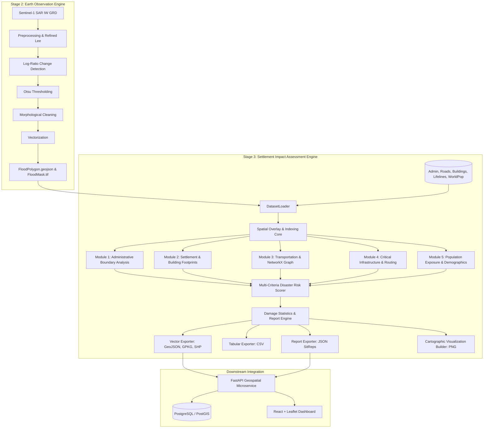
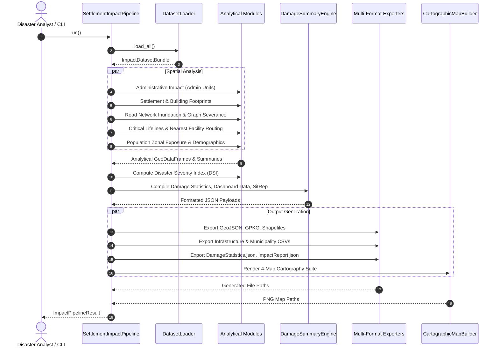

# SettlementImpactEngine — Software Architecture

## 1. High-Level System Architecture

`SettlementImpactEngine` is the Stage 3 disaster intelligence layer of **FloodGuard AI**. It bridges the gap between raw Sentinel-1 Earth Observation outputs (flood rasters and vectorized polygons) and operational humanitarian response for government agencies (such as Nepal's NDRRMA, UN-SPIDER, and OCHA).



---

## 2. Component Design & Responsibilities

| Module | Core Classes | Primary Responsibility |
| :--- | :--- | :--- |
| **`config`** | `ImpactConfig` | Single source of truth for study areas, CRS definitions, buffer tolerances, and export paths. |
| **`datasets`** | `DatasetLoader`, `MockNepalDataGenerator` | Harmonizes vector/raster inputs; provides built-in Nepal Terai geometries for offline zero-dependency execution. |
| **`utils`** | `get_logger`, `LogTimer`, `crs`, `geometry` | Metric area/length projections (UTM 45N / EPSG:32645), geometry repairs (`make_valid`), and timing. |
| **`overlay`** | `SpatialIntersectionEngine`, `SpatialIndexQuery`, `ZonalStatisticsEngine` | Fast STRtree nearest-neighbor lookups, planar polygon clipping, line-splitting, and proportional area math. |
| **`analysis`** | `AdministrativeImpactAnalyzer`, `SettlementImpactAnalyzer`, `InfrastructureImpactAnalyzer`, `DisasterRiskScorer` | Sectoral impact evaluations and multi-criteria disaster severity ranking (0–100 DSI). |
| **`network`** | `RoadImpactAnalyzer`, `RoadConnectivityGraph`, `AccessibilityAnalyzer` | Highway/bridge inundation, NetworkX topological graph fragmentation, and isolated settlement detection. |
| **`population`** | `PopulationExposureAnalyzer`, `PopulationDensityAnalyzer` | Proportional area population modeling, demographic vulnerability (children, elderly, displaced households). |
| **`statistics`** | `DamageSummaryEngine`, `TabularAggregator` | Unifies multi-sectoral metrics into `DamageStatistics.json`, `DashboardData.json`, and `ImpactReport.json`. |
| **`visualization`** | `CartographicMapBuilder`, `CartoStyle` | Publication-ready 200 DPI situational maps with north arrows, metric scale bars, and legends. |
| **`export`** | `VectorExporter`, `TabularExporter`, `ReportExporter` | Concurrently serializes GeoJSON, Shapefile, GeoPackage, CSV, and JSON deliverables. |

---

## 3. Data Flow Diagram



---

## 4. Integration with PostgreSQL/PostGIS & FastAPI

All generated spatial datasets are exported in standard WGS 84 (`EPSG:4326`) GeoJSON and OGC GeoPackage formats, allowing direct insertion into PostGIS without reprojection:
```sql
-- Automated PostGIS Ingestion
ALTER TABLE affected_buildings ADD COLUMN geom geometry(Polygon, 4326);
CREATE INDEX idx_affected_buildings_geom ON affected_buildings USING GIST (geom);
```
FastAPI endpoints can serve `DashboardData.json` directly to the frontend for sub-millisecond response times.
