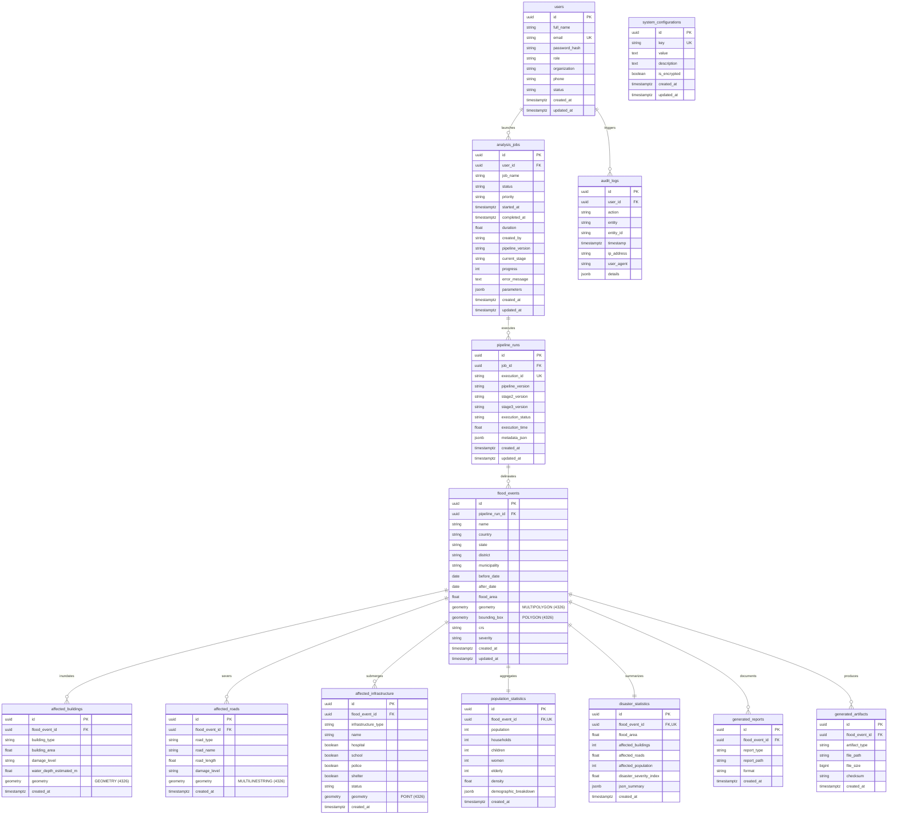

# FloodGuard AI — Geospatial Database Architecture & Schema Reference

Enterprise-grade PostgreSQL 16 + PostGIS spatial persistence layer for **FloodGuard AI**.

Built with **SQLAlchemy 2.0 (Async)**, **GeoAlchemy2**, and **Alembic**, this database acts as the single source of truth for user authentication, background job dispatching, pipeline execution telemetry, delineated flood inundation extents, settlement impact assessments, demographic vulnerability statistics, and cartographic deliverables.

---

## 🏛️ Entity Relationship Hierarchy

As specified in the architectural design, **`AnalysisJob`** serves as the processing root entity, establishing clear provenance from users down to localized disaster assets:

```
                       ┌──────────────┐
                       │     User     │
                       └──────┬───────┘
                              │ 1:N
                              ▼
                       ┌──────────────┐
                       │ AnalysisJob  │
                       └──────┬───────┘
                              │ 1:N
                              ▼
                       ┌──────────────┐
                       │ PipelineRun  │
                       └──────┬───────┘
                              │ 1:N
                              ▼
                       ┌──────────────┐
                       │  FloodEvent  │
                       └──────┬───────┘
                              │
       ┌──────────────┬───────┼───────┬──────────────┬──────────────┐
       │ 1:1          │ 1:1   │ 1:N   │ 1:N          │ 1:N          │ 1:N
       ▼              ▼       ▼       ▼              ▼              ▼
┌─────────────┐ ┌──────────┐ ┌─────┐ ┌────────────┐ ┌────────────┐ ┌─────────────────┐
│ Population  │ │ Disaster │ │Bldg │ │Road Segment│ │Critical    │ │Generated Reports│
│ Statistics  │ │Statistics│ │     │ │            │ │Facility    │ │& Artifacts      │
└─────────────┘ └──────────┘ └─────┘ └────────────┘ └────────────┘ └─────────────────┘
```

---

## 📊 Complete Mermaid ER Diagram



---

## 🗺️ Spatial Indexing & Geospatial Performance Strategy

### 1. Spatial Reference System (SRID)
- All geometries are standardized on **WGS 84 (`EPSG:4326`)** coordinates (longitude, latitude) matching Google Earth Engine, Sentinel-1 SAR orbit tiles, and OpenStreetMap building/road datasets.

### 2. PostGIS GiST Indexing
- **`flood_events.geometry`**: R-Tree over GiST index for fast spatial intersection (`ST_Intersects`, `ST_Contains`) with administrative boundaries and point assets.
- **`flood_events.bounding_box`**: GiST index for fast bounding-box viewport queries (`&&` operator) from interactive web maps (Leaflet / Mapbox / OpenLayers).
- **`affected_buildings.geometry`**: GiST spatial index supporting high-density queries over thousands of submerged footprints.
- **`affected_roads.geometry`**: GiST spatial index over submerged road networks.
- **`affected_infrastructure.geometry`**: GiST point index for rapid nearest-neighbor (`<->`) queries to relief hubs and shelters.

### 3. Composite & Filtering Indexes
- **`ix_flood_events_district_severity`**: `(district, severity)` for administrative dashboard filtering.
- **`ix_flood_events_temporal_window`**: `(before_date, after_date)` for historical monsoon crisis analysis.
- **`ix_affected_infra_event_type`**: `(flood_event_id, infrastructure_type)` and fast boolean flags (`hospital`, `school`, `shelter`).
- **`ix_users_role_status`**: `(role, status)` for security authentication lookups.

---

## 💻 Repository Usage Examples

### 1. Creating and Updating an Analysis Job
```python
from app.models.enums import JobPriority, JobStatus
from app.repositories.job import JobRepository

job_repo = JobRepository(session)

# Enqueue job
job = await job_repo.create(
    obj_in={
        "job_name": "Monsoon 2024 Koshi Assessment",
        "priority": JobPriority.HIGH,
        "parameters": {"aoi": "nepal_terai_koshi"},
    }
)

# Progress tracking during execution
await job_repo.update_progress(job.id, progress=50, current_stage="STAGE_2_FLOOD_DETECTION")

# Mark completed
await job_repo.mark_completed(job.id, duration=42.5)
```

### 2. Querying Flood Events with Full Impact Details
```python
from app.repositories.flood_event import FloodEventRepository

event_repo = FloodEventRepository(session)

# Fetch complete flood event with all child relationships loaded in a single query
event = await event_repo.get_with_full_details(event_id)

print(f"Disaster Severity Index: {event.disaster_statistics.disaster_severity_index}")
print(f"Submerged Buildings: {len(event.affected_buildings)}")
print(f"Affected Population: {event.population_statistics.population}")
for report in event.reports:
    print(f"Report Deliverable: {report.report_path} ({report.format})")
```

### 3. Querying Events by District and Severity
```python
from app.models.enums import FloodSeverity

# Retrieve critical flood events in Morang District
morang_events = await event_repo.find_by_district("Morang")
critical_events = await event_repo.find_by_severity(FloodSeverity.CRITICAL)
```

### 4. Logging Audit Events
```python
from app.repositories.audit import AuditRepository

audit_repo = AuditRepository(session)

await audit_repo.log_action(
    action="EXPORT_SITUATION_REPORT",
    entity="FloodEvent",
    entity_id=str(event.id),
    user_id=user.id,
    ip_address="192.168.1.15",
    details={"export_format": "PDF"},
)
```

---

## 🔄 Database Migration Workflow

Alembic manages asynchronous database migrations:

```bash
# Verify current migration status
alembic current

# Apply all migrations up to the latest revision
alembic upgrade head

# Rollback one migration step
alembic downgrade -1

# Generate a new autogenerated revision after modifying models
alembic revision --autogenerate -m "add_new_feature"
```
