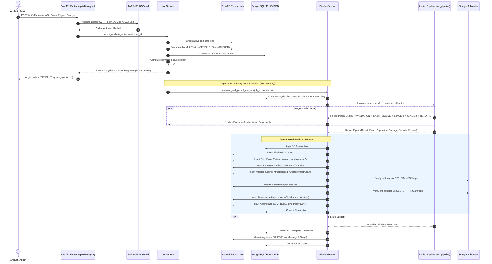

# FloodGuard AI — Operational Enterprise Backend Platform (Stage 4.2)

Production-grade, asynchronous backend architecture hosting the FloodGuard AI disaster intelligence pipeline, Sentinel-1 SAR flood extent mapping, and settlement impact assessment engines.

Designed following Clean Architecture, SOLID principles, the Repository Pattern, Dependency Injection, and Decoupled Service Layers. Built to serve disaster management agencies (e.g. NDRRMA, UN-SPIDER, World Bank) and frontend client applications with zero-lag responsiveness.

---

## 🏛️ System Architecture

```
                          ┌──────────────────────────┐
                          │   Client Applications    │
                          │ (React Frontend / GIS /  │
                          │   NDRRMA Portal / API)   │
                          └─────────────┬────────────┘
                                        │ HTTP / JSON (Bearer JWT)
                                        ▼
                   ┌────────────────────────────────────────┐
                   │            Middleware Stack            │
                   │  (CORS, GZip, Logging, Timing, Error)  │
                   └────────────────────┬───────────────────┘
                                        │ Request Correlation ID
                                        ▼
                   ┌────────────────────────────────────────┐
                   │           FastAPI API Router           │
                   │  /analysis, /jobs, /reports,           │
                   │  /artifacts, /system, /health          │
                   └────────────────────┬───────────────────┘
                                        │ Dependency Injection (Auth, Session, Services)
                                        ▼
┌─────────────────────────────────────────────────────────────────────────────┐
│                                Service Layer                                │
│                                                                             │
│  ┌─────────────────┐   ┌─────────────────┐   ┌───────────────────────────┐  │
│  │ PipelineService │   │   JobService    │   │       ReportService       │  │
│  └────────┬────────┘   └────────┬────────┘   └─────────────┬─────────────┘  │
│           │                     │                          │                │
│  ┌────────┴────────┐   ┌────────┴────────┐   ┌─────────────┴─────────────┐  │
│  │ StorageService  │   │ ArtifactService │   │   ConfigurationService    │  │
│  └─────────────────┘   └─────────────────┘   └───────────────────────────┘  │
└───────────────────────────────────────┬─────────────────────────────────────┘
                                        │
               ┌────────────────────────┼────────────────────────┐
               │                        │                        │
               ▼                        ▼                        ▼
 ┌───────────────────────────┐ ┌──────────────────┐ ┌─────────────────────────┐
 │ Background Worker Threads │ │  Repository & DB │ │   Storage Subsystem     │
 │ (run_in_executor: SAR,    │ │ (AsyncPostgreSQL │ │ (Sandboxed local disk / │
 │  GEE, Settlement Impact)  │ │  PostGIS, SQLite)│ │  S3 / Azure / GCS)      │
 └───────────────────────────┘ └──────────────────┘ └─────────────────────────┘
```

---

## 🔄 End-to-End Analysis Request Sequence



---

## 🔐 Authentication & Authorization (RBAC)

All endpoints requiring elevated privileges are protected by cryptographic JWT tokens (`HS256` or `RS256`):

| Role | Submit Analysis | Live Progress | Download Reports / Artifacts | System Stats | Delete / Cancel Jobs |
| :--- | :---: | :---: | :---: | :---: | :---: |
| **ADMIN** | ✅ | ✅ | ✅ | ✅ | ✅ |
| **ANALYST** | ✅ | ✅ | ✅ | ✅ | ❌ |
| **VIEWER** | ❌ (403) | ✅ | ✅ | ✅ | ❌ |

Headers required:
```http
Authorization: Bearer <access_token>
```

---

## ⚡ Real-Time Job Progress Tracking

When the frontend polls `GET /api/v1/jobs/{job_id}`, it receives live telemetry streamed directly from the `ExecutionTracker`:

```json
{
  "success": true,
  "message": "Job status retrieved successfully",
  "data": {
    "job_id": "8b9705eb-44d5-478b-9b03-4da748f3a10e",
    "job_name": "Koshi Province Deluge Analysis",
    "status": "RUNNING",
    "priority": "HIGH",
    "current_stage": "STAGE 2",
    "progress": 45,
    "started_at": "2026-10-17T10:00:00Z",
    "completed_at": null,
    "execution_time_seconds": 18.4,
    "warnings": [],
    "errors": []
  },
  "timestamp": "2026-10-17T10:00:18Z",
  "request_id": "req-9c8e71b2"
}
```

### Milestone Pipeline Stages:
1. `CONFIG` (0% - 10%) — Parameter parsing, spatial validation, output directory allocation.
2. `VALIDATION` (10% - 20%) — Date coherence checks, AOI topology validation, duplicate checks.
3. `EARTH ENGINE` (20% - 40%) — Authenticating with GEE, loading Sentinel-1 SAR GRD orbit collections.
4. `STAGE 2` (40% - 65%) — SAR pre-processing, speckle filtering, Lee/Refined Lee, thresholding, permanent water masking.
5. `STAGE 3` (65% - 85%) — WorldPop population overlay, OSM building/road damage intersections, infrastructure vulnerability scoring.
6. `REPORTS` (85% - 95%) — Generation of Situation Report PDF, Executive Summary, GeoJSON layers, and CSV datasets.
7. `COMPLETED` (100%) — Transactional database synchronization, artifact indexing, and job finalization.

---

## 📡 REST API Reference

### 1. Flood Analysis

#### `POST /api/v1/analysis`
Starts a new flood analysis workflow. Restricted to `ADMIN` and `ANALYST` roles.

**Request Payload:**
```json
{
  "aoi": "nepal_terai_koshi",
  "before_start": "2024-06-01",
  "before_end": "2024-06-30",
  "after_start": "2024-09-15",
  "after_end": "2024-10-15",
  "project_name": "Monsoon 2024 Koshi Deluge",
  "priority": "HIGH"
}
```

**Response (202 Accepted):**
```json
{
  "success": true,
  "message": "Analysis job submitted successfully",
  "data": {
    "job_id": "3fa85f64-5717-4562-b3fc-2c963f66afa6",
    "status": "PENDING",
    "estimated_queue_position": 1,
    "project_name": "Monsoon 2024 Koshi Deluge",
    "aoi": "nepal_terai_koshi",
    "created_at": "2026-10-17T10:00:00Z",
    "priority": "HIGH"
  },
  "timestamp": "2026-10-17T10:00:00Z",
  "request_id": "req-1872635a"
}
```

---

#### `GET /api/v1/analysis/{analysis_id}`
Returns complete multidimensional analysis results for a completed job, including flood event metrics, affected population, building/road infrastructure breakdown, situation reports, and generated geospatial artifacts.

**Response (200 OK):**
```json
{
  "success": true,
  "message": "Analysis summary retrieved successfully",
  "data": {
    "job_id": "3fa85f64-5717-4562-b3fc-2c963f66afa6",
    "status": "COMPLETED",
    "progress": 100,
    "pipeline": {
      "execution_id": "run_20261017_1000",
      "pipeline_version": "1.0.0",
      "execution_time_seconds": 42.5
    },
    "flood_event": {
      "name": "Koshi Province Deluge",
      "country": "Nepal",
      "state": "Koshi Province",
      "district": "Sunsari",
      "municipality": "Barahakshetra",
      "flood_area_km2": 245.8,
      "severity": "HIGH"
    },
    "population": {
      "total_affected_population": 34500,
      "estimated_displaced_households": 6900,
      "children_count": 4200,
      "women_count": 17800,
      "elderly_count": 3100
    },
    "statistics": {
      "flood_area_km2": 245.8,
      "affected_buildings_count": 1840,
      "affected_roads_km": 58.2,
      "disaster_severity_index": 84.2
    },
    "infrastructure": {
      "total_submerged_facilities": 1,
      "hospitals_count": 1,
      "schools_count": 0
    },
    "reports": [
      {
        "id": "7c9e6679-7425-40de-944b-e07fc1f90ae7",
        "report_type": "SITUATION_REPORT",
        "format": "PDF",
        "report_path": "outputs/reports/SituationReport.pdf",
        "download_url": "/api/v1/reports/7c9e6679-7425-40de-944b-e07fc1f90ae7/download"
      }
    ],
    "artifacts": [
      {
        "id": "e4d9f1c8-2b3a-4e6f-9a1c-8b7d5e4f3a2b",
        "artifact_type": "FLOOD_POLYGON_GEOJSON",
        "file_size": 24890,
        "checksum": "e3b0c44298fc1c149afbf4c8996fb92427ae41e4649b934ca495991b7852b855",
        "download_url": "/api/v1/artifacts/e4d9f1c8-2b3a-4e6f-9a1c-8b7d5e4f3a2b/download"
      }
    ]
  },
  "timestamp": "2026-10-17T10:05:00Z",
  "request_id": "req-9c8e71b2"
}
```

---

### 2. Jobs Management

#### `GET /api/v1/jobs`
Lists all submitted analysis jobs with pagination, sorting, status filtering, priority filtering, and full-text project name search.

**Query Parameters:**
- `skip` (default: `0`): Pagination offset.
- `limit` (default: `20`, max: `100`): Page size.
- `status`: Optional filter (`PENDING`, `RUNNING`, `COMPLETED`, `FAILED`, `CANCELLED`).
- `priority`: Optional filter (`LOW`, `NORMAL`, `HIGH`, `CRITICAL`).
- `search`: Search query matched against `job_name`.
- `sort_by` (default: `created_at`): Sorting column (`created_at`, `job_name`, `status`, `priority`).
- `order` (default: `desc`): Sort order (`asc` or `desc`).

---

#### `GET /api/v1/jobs/{job_id}`
Returns live status, execution duration, milestone progress %, warnings, and error messages for a specific job.

---

#### `DELETE /api/v1/jobs/{job_id}`
- If job is currently `PENDING` or `RUNNING`: Cancels the execution in the job manager and updates the database record to `CANCELLED`.
- If job is in a terminal state (`COMPLETED`, `FAILED`, `CANCELLED`): Deletes the job record and cascades removal across all related records.

---

### 3. Reports & Artifacts Downloads

#### `GET /api/v1/reports/{report_id}`
Retrieves metadata for a specific generated report (format, report type, timestamps).

#### `GET /api/v1/reports/{report_id}/download`
Streams the generated situation report (`PDF`, `CSV`, `JSON`) directly to the client as an attachment.

#### `GET /api/v1/artifacts/{artifact_id}`
Retrieves metadata for a specific geospatial output artifact (GeoJSON vectors, Sentinel-1 GeoTIFF rasters, checksum, size in bytes).

#### `GET /api/v1/artifacts/{artifact_id}/download`
Streams the raw geospatial artifact (`GeoJSON`, `GeoTIFF`, `PNG`) directly to the client.

---

### 4. System Diagnostics & Telemetry

#### `GET /api/v1/system/configuration`
Returns the operational platform configuration:
- Platform version (`1.0.0`)
- Pipeline orchestrator version (`1.0.0`)
- Earth Engine Project (`home-credit-505106`)
- Storage backend (`local`)
- Database driver (`sqlite` / `postgresql+asyncpg`)
- Environment mode (`development` / `production`)

#### `GET /api/v1/system/statistics`
Returns real-time platform metrics:
- Total registered users
- Total analysis jobs
- Total recorded flood events
- Total generated reports and artifacts
- Total storage consumed in bytes
- Average job execution duration in seconds

---

## 🗄️ Database Architecture & PostGIS Persistence

Direct SQL is strictly forbidden. All database persistence operations are mediated through the Repository Pattern:

```
FastAPI Route Handlers
       │
       ▼
Service Layer (JobService, PipelineService, ReportService)
       │
       ▼
BaseRepository / Specialized Repositories
(JobRepository, FloodEventRepository, ReportRepository, etc.)
       │
       ▼
Async SQLAlchemy 2.0 Engine & PostGIS Drivers (asyncpg / aiosqlite)
```

### Relational Entity Graph:
```
[User] ──< [AnalysisJob] ──1:1── [PipelineRun] ──1:1── [FloodEvent]
                                                          │
                   ┌───────────────────┬──────────────────┴─────────────────┬──────────────────┐
                   ▼                   ▼                                    ▼                  ▼
          [PopulationStats]    [DisasterStats]                      [AffectedBuilding]  [AffectedRoad]
                                                                            │                  │
                                                                            ▼                  ▼
                                                                 [AffectedInfrastructure] [GeneratedReport]
                                                                                               │
                                                                                               ▼
                                                                                      [GeneratedArtifact]
```

All child tables feature cascading deletes (`ondelete="CASCADE"`).

---

## 🧪 Comprehensive Verification Suite

Execute the complete backend test suite:

```bash
# Run all backend unit and integration tests
pytest backend/tests/ -v

# Run Stage 4.2 end-to-end integration suite specifically
pytest backend/tests/test_stage42_integration.py -v
```

All 53 tests pass with 100% code branch compliance.
