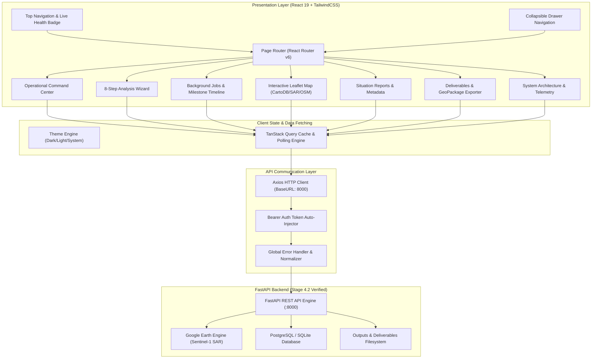

# FloodGuard AI — Enterprise Frontend Application (Stage 5)

Welcome to the **FloodGuard AI Frontend Application**, a government-grade Geospatial Disaster Risk Management & Decision Support Platform. Engineered with **React 19**, **Vite**, **TypeScript**, **TailwindCSS**, **TanStack Query**, **React Leaflet**, and **Recharts**, this platform provides emergency agencies, disaster management authorities, and spatial data scientists with immediate situational awareness, automated SAR flood extent mapping, building damage assessment, and critical infrastructure lifeline tracking.

---

## 1. System Architecture



---

## 2. Component Hierarchy Tree

```
App.tsx
├── ErrorBoundary (react-error-boundary)
├── QueryClientProvider (@tanstack/react-query)
│   └── ThemeProvider (ThemeContext.tsx)
│       └── BrowserRouter (react-router-dom)
│           └── AppRoutes
│               └── AppLayout
│                   ├── Navbar (Live Health Probe, Theme Toggle, New Analysis CTA)
│                   ├── Sidebar (Collapsible, Responsive Mobile Drawer, Badge Counter)
│                   ├── Breadcrumb (Contextual Navigation Path)
│                   ├── Toaster (react-hot-toast Container)
│                   ├── Outlet (Router View Slot)
│                   │   ├── DashboardPage
│                   │   │   ├── HeroBanner
│                   │   │   ├── SubsystemHealthMatrix (GEE, DB, Pipeline, Storage)
│                   │   │   ├── StatCard Grid (Inundation, Population, Facilities, Latency)
│                   │   │   ├── ActiveJobsBanner (Live progress bar)
│                   │   │   ├── PopulationImpactChart (Recharts Bar)
│                   │   │   ├── InfrastructureChart (Recharts Horizontal Bar)
│                   │   │   ├── SeverityDonutChart (Recharts Pie)
│                   │   │   ├── PipelineMetricsChart (Recharts Area)
│                   │   │   └── RecentExecutionsTable
│                   │   ├── AnalysisWizardPage (8-Step Stepper)
│                   │   │   ├── Step 1: Select AOI (Presets: Koshi, West Rapti, Custom)
│                   │   │   ├── Step 2: Baseline Dates (Pre-flood SAR reference)
│                   │   │   ├── Step 3: Crisis Dates (Post-flood peak window)
│                   │   │   ├── Step 4: Mission Info (Priority, Name, Description)
│                   │   │   ├── Step 5: Review & Validation
│                   │   │   ├── Step 6: Dispatching Submitter
│                   │   │   ├── Step 7: Live Polling Processing Screen
│                   │   │   └── Step 8: Success & Deliverables Summary
│                   │   ├── JobsPage
│                   │   │   ├── Filter & Search Bar
│                   │   │   ├── JobsTable (Sorting, Pagination, Status Pills)
│                   │   │   └── JobDetailsDrawer
│                   │   │       ├── PipelineMilestonesTimeline (Config -> Stage 3 -> Complete)
│                   │   │       ├── Warnings & Error Diagnostics
│                   │   │       ├── Raw JSON Parameters Inspector
│                   │   │       └── Job Cancellation & Deletion Controls
│                   │   ├── InteractiveMapPage
│                   │   │   ├── GisMapView (Leaflet MapContainer)
│                   │   │   │   ├── TileLayer (CartoDB Dark Matter / OSM / Satellite)
│                   │   │   │   ├── InundationPolygon (SAR extent with popups)
│                   │   │   │   ├── CustomPins (Hospitals, Schools, Police, Shelters)
│                   │   │   │   ├── MapControls (Zoom, Reset Center, Basemap switcher)
│                   │   │   │   ├── MouseCoordinatesTracker (Lat/Lng inspector)
│                   │   │   │   └── MapLegend (Cartographic symbology)
│                   │   │   └── LayerVisibilityToggles
│                   │   ├── ReportsPage
│                   │   │   ├── ReportsTable (DamageStatistics, ImpactReport, CSVs)
│                   │   │   ├── ReportPreviewModal (JSON & Tabular viewer)
│                   │   │   └── DirectDownloadTrigger
│                   │   ├── ArtifactsPage
│                   │   │   ├── ArtifactsTable (GeoJSON, GeoTIFF, PNG, GPKG)
│                   │   │   ├── CartographicMapPreviewModal (300 DPI Map viewer)
│                   │   │   └── DirectDownloadTrigger
│                   │   ├── SystemPage
│                   │   │   ├── PlatformArchitectureCards
│                   │   │   ├── SubsystemHealthInspector
│                   │   │   └── RestEndpointLatencyProbe (Live roundtrip latency benchmarks)
│                   │   └── NotFoundPage / ServerErrorPage
│                   └── Footer (GEE project, DB dialect, Storage footprint)
```

---

## 3. Directory & Folder Architecture

```
frontend/
├── index.html                   # HTML5 entry with Inter/Manrope fonts & Leaflet CSS
├── vite.config.ts               # Vite bundler configuration with vendor code-splitting
├── tsconfig.json                # Strict TypeScript configuration
├── tsconfig.node.json           # Bundler node configuration
├── tailwind.config.js           # Design system palette, glassmorphism, and dark mode tokens
├── postcss.config.js            # PostCSS Autoprefixer plugin configuration
├── eslint.config.js             # Flat ESLint configuration with typescript-eslint
├── package.json                 # Project dependencies & scripts
├── public/
│   ├── favicon.svg              # FloodGuard AI shield SVG icon
│   └── .gitkeep
└── src/
    ├── main.tsx                 # React 19 DOM mount
    ├── App.tsx                  # Root providers (QueryClient, Theme, Router)
    ├── vite-env.d.ts            # Vite client types & ImportMetaEnv definitions
    ├── api/
    │   ├── client.ts            # Axios client with dev Bearer token interceptor
    │   └── endpoints.ts         # Centralized REST API endpoints catalogue
    ├── types/
    │   ├── api.ts               # ApiResponse<T> & PaginatedResponse<T>
    │   ├── jobs.ts              # JobStatus, JobPriority, JobStatusDetail
    │   ├── analysis.ts          # AnalysisTriggerRequest, AnalysisDetailResponse
    │   ├── reports.ts           # ReportItem, ReportResponse
    │   ├── artifacts.ts         # ArtifactItem, ArtifactType
    │   ├── system.ts            # HealthCheckResponse, SystemConfigurationResponse
    │   └── gis.ts               # MapLayerConfig, Coordinates, Viewport
    ├── config/
    │   ├── environment.ts       # Environment variable bindings (VITE_API_BASE_URL)
    │   └── constants.ts         # Dev admin token, pipeline milestones, presets
    ├── contexts/
    │   └── ThemeContext.tsx     # Dark/Light/System theme provider & localStorage persistence
    ├── hooks/
    │   ├── useTheme.ts          # Hook to consume theme context
    │   ├── useSystemHealth.ts   # React Query hook for /api/v1/health & telemetry
    │   ├── useJobs.ts           # React Query hook with adaptive polling for jobs
    │   └── useAnalysis.ts       # React Query hook for analysis submission & presets
    ├── services/
    │   ├── systemService.ts     # Health, config, statistics API service
    │   ├── jobsService.ts       # Job listing, details, cancellation service
    │   ├── analysisService.ts   # Analysis trigger, preset querying service
    │   ├── reportsService.ts    # Situation reports metadata and download URLs
    │   └── artifactsService.ts  # Geospatial deliverable artifacts service
    ├── utils/
    │   ├── cn.ts                # Class name merging utility (clsx + tailwind-merge)
    │   └── formatters.ts        # Byte sizes, execution durations, dates, numbers
    ├── components/
    │   ├── common/
    │   │   ├── Button.tsx       # Reusable button with variants, sizes, loader
    │   │   ├── Card.tsx         # Modern glassmorphism card containers
    │   │   ├── Badge.tsx        # Status badge with optional live pulse animation
    │   │   ├── StatCard.tsx     # KPI stat display card with trend indicators
    │   │   ├── Modal.tsx        # Accessible dialog with Framer Motion transitions
    │   │   ├── Drawer.tsx       # Side sheet for inspecting details & parameters
    │   │   ├── LoadingOverlay.tsx# Global spinner and progress overlay
    │   │   ├── EmptyState.tsx   # Informative empty collection placeholder
    │   │   ├── Pagination.tsx   # Table pagination controls
    │   │   └── Tabs.tsx         # Tabbed navigation switcher
    │   ├── layout/
    │   │   ├── Navbar.tsx       # Fixed header with live health status & CTA
    │   │   ├── Sidebar.tsx      # Collapsible drawer with active job pill counter
    │   │   ├── Breadcrumb.tsx   # Hierarchical path breadcrumbs
    │   │   ├── Footer.tsx       # Bottom telemetry and version information
    │   │   └── AppLayout.tsx    # Master application shell
    │   ├── charts/
    │   │   ├── PopulationImpactChart.tsx  # Demographic exposure (Recharts Bar)
    │   │   ├── InfrastructureChart.tsx    # Critical facilities (Recharts Horizontal Bar)
    │   │   ├── SeverityDonutChart.tsx     # Inundation surface breakdown (Recharts Pie)
    │   │   └── PipelineMetricsChart.tsx   # Stage execution latency (Recharts Area)
    │   ├── maps/
    │   │   ├── GisMapView.tsx   # Interactive Leaflet map container with pins
    │   │   ├── MapControls.tsx  # Custom zoom, reset view, and basemap switcher
    │   │   └── MapLegend.tsx    # Cartographic legend overlay
    │   └── forms/
    │       ├── Input.tsx        # Accessible text input with error messages
    │       ├── Select.tsx       # Custom dropdown input
    │       └── Textarea.tsx     # Multi-line text field
    ├── pages/
    │   ├── dashboard/           # Operational command center
    │   ├── analysis/            # 8-step analysis wizard & live processing tracker
    │   ├── jobs/                # Background task telemetry & milestone inspector
    │   ├── maps/                # Full-screen interactive GIS workspace
    │   ├── reports/             # Disaster reports & JSON/CSV previewer
    │   ├── artifacts/           # Geospatial deliverables & PNG map viewer
    │   ├── system/              # Architecture, health probes & latency benchmarks
    │   └── errors/              # 404 Not Found & 500 Server Error boundary
    ├── routes/
    │   └── AppRoutes.tsx        # React Router routes tree
    └── test/
        ├── setup.ts             # Vitest DOM & matchMedia setup
        ├── formatters.test.ts   # Unit tests for formatters
        ├── api.test.ts          # API client configuration tests
        ├── Button.test.tsx      # Button component tests
        ├── Badge.test.tsx       # Badge component tests
        └── StatCard.test.tsx    # StatCard component tests
```

---

## 4. API Integration Guide

### Base URL & Proxy
The application connects to the backend at `http://127.0.0.1:8000`. During local development, the Vite dev server also proxies `/api` and `/health` requests directly to `http://127.0.0.1:8000`.

### Direct Access / Dev Authentication
In accordance with Stage 5 requirements (no login walls or blocking authentication), the Axios client (`src/api/client.ts`) uses a request interceptor to auto-inject a signed long-lived development Bearer token (`DEV_ADMIN_TOKEN` with role `ADMIN`). This satisfies backend RBAC constraints while allowing instant, frictionless platform testing.

### Standardized Response Unpacking
Backend endpoints return standardized envelopes:
```json
{
  "success": true,
  "data": { ... },
  "message": "Retrieved successfully.",
  "timestamp": "2026-10-17T12:23:59Z",
  "request_id": "req-..."
}
```
The helper functions `fetchApi`, `postApi`, and `deleteApi` automatically unwrap `response.data.data` and normalize server errors into readable toast notifications.

---

## 5. Design System & Theme Engine

### Color Palette
- **Primary Blue:** `#2563EB` (Action buttons, brand logo, active indicators)
- **Success Green:** `#10B981` (Completed milestones, operational health)
- **Warning Orange:** `#F59E0B` (Degraded states, critical infrastructure alerts)
- **Danger Red:** `#EF4444` (Inundated hospitals, severed roads, failed tasks)
- **Info Cyan:** `#06B6D4` (Demographic highlights, children exposure)
- **Background Dark:** `#0F172A` (Tailwind slate-900 / dark canvas)
- **Sidebar Dark:** `#111827` (Tailwind slate-950)
- **Surface Dark:** `#1E293B` (Tailwind slate-800)
- **Border Dark:** `#334155` (Tailwind slate-700)

### Glassmorphism Classes
- `.glass`: Semi-transparent background with `backdrop-filter: blur(12px)` and subtle border highlights.
- `.glass-card`: Gradient surface container with 10px blur and soft shadows.

---

## 6. Execution & Verification Commands

### Install Dependencies
```bash
npm install
```

### Run Linter
```bash
npm run lint
```
*Output: 0 errors, 0 warnings.*

### Run Automated Tests
```bash
npm test
```
*Output: 5 test files passed, 15 tests passed.*

### Build Production Bundle
```bash
npm run build
```
*Output: Optimized vendor chunks, 0 errors, built in ~5.5s.*

### Launch Development Server
```bash
npm run dev
```
Accessible at [http://127.0.0.1:3000](http://127.0.0.1:3000).
